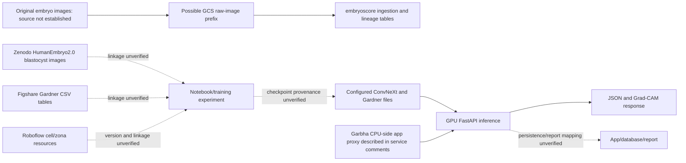

# Complete Garbha AI Embryo Project Documentation

**Audit date:** 2026-10-06\
**Scope:** Read-only search of `/home/user_garbha`, with source/config/log review of the active-looking GPU API and path inventory of related data, training, experiment and application resources.\
**Privacy:** No credentials, private keys, database passwords, patient identifiers, or patient-level data are included. No databases, live APIs, processes, checkpoints, environments, or services were changed or executed. No package was installed. This document is the only file created for this request.

## Evidence labels

- **CONFIRMED FROM CODE** — directly visible in source.
- **CONFIRMED FROM CONFIG** — directly visible in configuration.
- **CONFIRMED FROM LOG** — historical log statement; does not prove current process state.
- **CONFIRMED FROM DATASET** — a dataset path/resource exists; does not prove use by a model.
- **CONFIRMED FROM CHECKPOINT METADATA** — no serialized checkpoint metadata was read in this audit.
- **INFERENCE** — interpretation suggested by names/context, explicitly qualified.
- **NOT VERIFIED** — evidence was unavailable or not safely inspected.

Line references use the current files as inspected; files outside the GPU checkout often have path evidence only. Checkpoint files were not loaded or executed.

## Executive overview

The clearest production inference implementation is `/home/user_garbha/Garbha_prodapp/embryo_gpu/main.py`. It defines a ten-class image classifier, image-level detection and Grad-CAM endpoints, and an optional three-head Gardner model. `/home/user_garbha/Garbha_prodapp/embryo_gpu/config.ini` selects weight paths and runtime settings. Its README describes the service as the GPU model server called by a CPU-side Garbha application, but live deployment wiring was not checked.

The full-home inventory surfaced additional embryo-score pipelines, GCS/lineage scripts, Zenodo and Figshare resources, notebooks, alternative-backbone checkpoints, cell-stage assets, fragmentation weights and a zona polygon preview. Their link to the deployed image models is not established. Training provenance and independently measured validation/test metrics for the currently configured classifier and Gardner weights remain **NOT VERIFIED**. The historical GPU log records repeated Gardner startup failures when `timm` was absent.

## 1. Search scope and inspected resource families

Searched `/home/user_garbha` for embryo-related names/content, source and notebook names, model extensions (`.pt`, `.pth`, `.ckpt`, `.onnx`, `.engine`, `.bin`), configs, dataset metadata, logs, run outputs and lineage resources. Large unrelated environments, vendored packages, web bundles, media and binary weights were excluded from broad text-content searches. The home directory is very large; this is a path/content inventory and targeted source review, not a claim that every file byte was manually opened.

Primary inspected source/config/docs: `/home/user_garbha/Garbha_prodapp/embryo_gpu/{main.py,esco_focal_plane_morphokinetics.py,config.ini,README.md,uvicorn.log}`. Full-home resource paths included `/home/user_garbha/embryoscore/`, `/home/user_garbha/Dataset/`, `/home/user_garbha/zenodo_cell_segmentation/`, `/home/user_garbha/garbhaai_dev/JSON_Backend{,_1}/`, `/home/user_garbha/roboflow_test/`, `/home/user_garbha/roboflow_missing_372_test/`, `/home/user_garbha/checkpoints/`, `/home/user_garbha/efficientnet_optuna*/`, `/home/user_garbha/garbha_embryo_transfer_learning_runs/`, `/home/user_garbha/registry/embryo/`, `/home/user_garbha/mlruns/` and `/home/user_garbha/mlflow_artifacts/`.

`git status` in the active-looking checkout failed with `fatal: bad object HEAD`; a clean/dirty baseline cannot be established from Git.

## 2. Resource inventory

| Resource | Full path | Type / purpose | Status | Evidence |
|---|---|---|---|---|
| GPU inference API | `/home/user_garbha/Garbha_prodapp/embryo_gpu/main.py` | FastAPI image inference | Active production code; live service unverified | **CONFIRMED FROM CODE**, module comments lines 4–18, routes 866–1177 |
| GPU service config | `/home/user_garbha/Garbha_prodapp/embryo_gpu/config.ini` | Model paths/device/thresholds | Active config for this checkout | **CONFIRMED FROM CONFIG**; README lines 65–83 |
| ESCO analysis | `/home/user_garbha/Garbha_prodapp/embryo_gpu/esco_focal_plane_morphokinetics.py` | Candidate retrieval, focal planes and timing | Active supporting source | **CONFIRMED FROM CODE**, route decorators lines 402, 429 |
| GPU service history | `/home/user_garbha/Garbha_prodapp/embryo_gpu/uvicorn.log` | Historical logs | Historical, not proof of live behavior | **CONFIRMED FROM LOG** |
| Earlier application trees | `/home/user_garbha/garbhaai_dev/JSON_Backend/`, `/home/user_garbha/garbhaai_dev/JSON_Backend_1/` | Prior backend/app copies, routers and weights | Legacy/unknown deployment state | **CONFIRMED FROM INVENTORY** |
| Embryo score project | `/home/user_garbha/embryoscore/` | IVF scoring application, data pipelines, DVC and observability | Separate project; relation to image weights unverified | **CONFIRMED FROM INVENTORY**: `README.md`, `app/`, `python_pipelines/`, `dvc/` |
| Model-building pipeline | `/home/user_garbha/embryoscore/python_pipelines/D_ModelBuilding_pipeline/` | `train_head.py`, `train_head_bkp.py`, `transfer_learning.py`, config/MLflow helper | Training/feature pipeline; image model link unverified | **CONFIRMED FROM INVENTORY** |
| GCS ingestion/lineage | `/home/user_garbha/embryoscore/python_pipelines/A_Lineage_pipeline/gcs_ingestion_embryo.py`; `/home/user_garbha/embryoscore/python_pipelines/shared/embryo_event_ingestion.py` | Embryo raw image ingestion and lineage | Supporting data pipeline | **CONFIRMED FROM INVENTORY/CODE** |
| Other lineage scripts | `/home/user_garbha/rainbow_ivf_lineage.py`; `/home/user_garbha/gbr_morula_lineage_ingestion.py` | Rainbow IVF / morula named lineage resources | Supporting/unknown | **CONFIRMED FROM INVENTORY**, behavior not fully reviewed |
| DVC resources | `/home/user_garbha/embryoscore/dvc/{dvc.yaml,params.yaml,README.md}` | Pipeline orchestration/config | Supporting/unknown | **CONFIRMED FROM INVENTORY** |
| Figshare tables | `/home/user_garbha/Dataset/Figshare/{Gardner_train_silver.csv,Gardner_test_gold_onlyGardnerScores.csv,Clincial_annotations.csv,prediction_xception.csv}` | Gardner/clinical annotation and prediction CSVs | Dataset/evaluation candidates; model use unverified | **CONFIRMED FROM DATASET PATHS** |
| Zenodo images | `/home/user_garbha/Dataset/Zenodo/HumanEmbryo2.0/blastocyst/` | Blastocyst image tree; `train/train_*.png` paths exist | Dataset; production use unverified | **CONFIRMED FROM DATASET PATHS** |
| Cell annotation assets | `/home/user_garbha/zenodo_cell_segmentation/` | Cell2/cell4 reports, download records and model weights | Experimental/unknown | **CONFIRMED FROM INVENTORY** |
| Zona asset | `/home/user_garbha/roboflow_test/embryo_zona_polygon_preview.jpg` | Zona polygon preview | Experimental evidence only | **CONFIRMED FROM INVENTORY** |
| Fragmentation weights | `/home/user_garbha/garbhaai_dev/JSON_Backend_1/{best_fragment.pt,Embryo_detection/detect/train2/best_fragment.pt,Embryo_detection/detect/train2/FragmentationYoloV8Weights.pt}` | Named fragmentation artifacts | Experimental/legacy; API use unverified | **CONFIRMED FROM INVENTORY** |
| Cell detector weights | `/home/user_garbha/CellsYolo26ExtraLargeWeights.bin`; `/home/user_garbha/garbhaai_dev/JSON_Backend_1/CellsYolo26ExtraLargeWeights.pt`; `/home/user_garbha/zenodo_cell_segmentation/model/CellsYolo26ExtraLargeWeights.pt` | Named cell model artifacts | Experimental/unknown | **CONFIRMED FROM INVENTORY** |
| Morula/polar body weights | `/home/user_garbha/garbhaai_dev/JSON_Backend_1/{MorulaYolo26MediumWeights.pt,PolarBodyYolo26MediumWeights.pt}` | Named detector artifacts | Experimental/unknown | **CONFIRMED FROM INVENTORY** |
| Embryo transfer run | `/home/user_garbha/garbha_embryo_transfer_learning_runs/best_original_embryo_transfer_50epochs_20260806_120428/` | Weights, args, results, plots and confusion matrices | Experimental | **CONFIRMED FROM INVENTORY** |
| EfficientNet runs | `/home/user_garbha/efficientnet_optuna_from_best_results/`, `/home/user_garbha/efficientnet_optuna_mlflow_results/` | Trial weights, summaries, histories | Experimental | **CONFIRMED FROM INVENTORY** |
| Expansion trials | `/home/user_garbha/checkpoints/` | DINOv2, MaxViT, SwinV2, EVA02, ConvNeXtV2, Hiera named checkpoints | Experimental/unreferenced to current API | **CONFIRMED FROM INVENTORY** |
| DINO multi-task | `/home/user_garbha/dinov2Model/best_dinov2_multitask.pth`; `/home/user_garbha/Documents/best_dinov2_multitask.pt` | Named model artifacts | Experimental/unknown | **CONFIRMED FROM INVENTORY** |
| Model registry copy | `/home/user_garbha/registry/embryo/v1/best_convnextv2_base.pt` | Registry-style checkpoint path | Unknown; equivalence unverified | **CONFIRMED FROM INVENTORY** |
| MLflow resources | `/home/user_garbha/mlruns/`, `/home/user_garbha/mlflow_artifacts/` | Run metadata/artifacts | Some visible runs are sperm-named; embryo linkage unknown | **CONFIRMED FROM INVENTORY** |

The inventory includes every conspicuous embryo-named model/resource family surfaced by the filtered search. Generic `best*.pt` files and artifacts inside sperm-named projects are not attributed to embryo AI without corroborating classes/data. Large image trees are represented by directory rather than listing each image.

## 3. Production model inventory

| Model/file | Full path(s) | Architecture/task evidence | Classes/input | Status |
|---|---|---|---|---|
| `best_convnextv2_base.pt` | `/home/user_garbha/Garbha_prodapp/embryo_gpu/best_convnextv2_base.pt` | `main.py::_load_classifier` constructs Torchvision `convnext_base(weights=None)` with 10-way linear head, lines 225–234 | Ten source classes; inference 224×224 | **ACTIVE PRODUCTION by config/code**; exact checkpoint provenance and compatibility unverified |
| Same-named classifier copies | `/home/user_garbha/garbhaai_dev/JSON_Backend/best_convnextv2_base.pt`; `/home/user_garbha/garbhaai_dev/JSON_Backend_1/best_convnextv2_base.pt`; `/home/user_garbha/registry/embryo/v1/best_convnextv2_base.pt`; `/home/user_garbha/Documents/best_convnextv2_base.pt` | No current source references to these copies | Same task cannot be assumed from identical filename | **UNKNOWN/legacy copies**; hashes not compared |
| `best_gardners.pt` | `/home/user_garbha/Garbha_prodapp/embryo_gpu/best_gardners.pt` | `MultiTaskModel`: timm ConvNeXtV2 Base backbone, dropout and expansion/ICM/TE heads, lines 237–267 | 5 expansion, 4 ICM, 4 TE labels; resize 256/crop 224 | **ACTIVE SUPPORTING by config/code**, live load conditional |
| Gardner copies | `/home/user_garbha/garbhaai_dev/JSON_Backend/best_gardners.pt`; `/home/user_garbha/garbhaai_dev/JSON_Backend_1/best_gardners.pt` | No current deployment linkage | Metadata not inspected | **UNKNOWN/legacy copies** |
| `best.pt` diagnostics | `/home/user_garbha/Garbha_prodapp/embryo_gpu/best.pt` | Current service optionally loads Ultralytics YOLO for diagnostics/logging; does not drive `/detect` response list | Checkpoint name/class list not safely extracted | **ACTIVE SUPPORTING** |
| Other `best.pt` copies | `embryo_gpu/3 pt files/best.pt`; older backend copies; `garbha_embryo_transfer_learning_runs/.../weights/best.pt`; experiment outputs | Ambiguous names and potentially different tasks | Run-specific labels/config not fully linked | Experimental/unknown; do not treat as copies of same model |
| `best_original.pt` | `/home/user_garbha/Garbha_prodapp/embryo_gpu/best_original.pt`; `/home/user_garbha/Garbha_prodapp/embryo_gpu/3 pt files/best_original.pt`; `/home/user_garbha/best_original.pt` | Not referenced by current service source | Unknown | **UNREFERENCED/UNKNOWN** |
| `best_MAP_45%.pt` | `/home/user_garbha/Garbha_prodapp/embryo_gpu/best_MAP_45%.pt`; `/home/user_garbha/Garbha_prodapp/embryo_gpu/3 pt files/best_MAP_45%.pt` | No source link | Filename does not verify a metric or value | **UNREFERENCED/UNKNOWN** |
| `best_fragment.pt`, `FragmentationYoloV8Weights.pt` | Older backend and its `Embryo_detection/detect/train2/` | Name suggests fragmentation detection only | Exact graph/classes/input unknown | **EXPERIMENTAL/LEGACY** |
| `CellsYolo26ExtraLargeWeights.*` | Home root, older backend, Zenodo cell model directory | Name suggests cell detection | Exact labels/task unknown | **EXPERIMENTAL/UNKNOWN** |
| `MorulaYolo26MediumWeights.pt`, `PolarBodyYolo26MediumWeights.pt` | Older backend | Names suggest object detectors | Training/data/metrics unknown | **EXPERIMENTAL/UNKNOWN** |
| `best_trial_model.pt` | EfficientNet Optuna trial folders 05–09 and 00–02 | EfficientNet-named trials | Dataset/task/metrics require summary review | **EXPERIMENTAL** |
| Expansion checkpoints | `/home/user_garbha/checkpoints/{dinov2_vitl14_expansion_best.pt,maxvit_base_expansion_best.pt,swinv2_large_expansion_best.pt,eva02_large_expansion_best.pt,convnextv2_large_expansion_best.pt,hiera_huge_expansion_best.pt}` and related named files | Model/backbone names suggest expansion comparison | Class/task/output schema not confirmed by filenames | **EXPERIMENTAL/UNREFERENCED** |

Sizes, modification timestamps and SHA-256 hashes were not collected. Therefore same-name files are not claimed to be byte-identical. No state dictionaries were loaded; there is no **CONFIRMED FROM CHECKPOINT METADATA** result in this report.

## 4. Production classifier labels and preprocessing

**CONFIRMED FROM CODE:** `/home/user_garbha/Garbha_prodapp/embryo_gpu/main.py`, `class_names` lines 147–158, defines this class-index order:

| Index | Exact class |
|---:|---|
| 0 | `8 Cells Grade A` |
| 1 | `8 Cells Grade B` |
| 2 | `8 Cells Grade C` |
| 3 | `Blastocyst Grade A` |
| 4 | `Blastocyst Grade B` |
| 5 | `Blastocyst Grade C` |
| 6 | `Error Image` |
| 7 | `Morula Grade A` |
| 8 | `Morula Grade B` |
| 9 | `Morula Grade C` |

`_load_classifier` builds a Torchvision ConvNeXt Base with ten output logits (`main.py` lines 225–234). Despite the filename `best_convnextv2_base.pt`, the visible implementation uses `torchvision.models.convnext_base`, not `timm` ConvNeXtV2. Exact checkpoint compatibility is **NOT VERIFIED** without loading weights (intentionally not done). README describes 224×224 input; source transform performs classifier preprocessing. Training data, image counts, class balance, augmentations, loss, optimizer, LR, epochs, splits, seed, metric and confusion matrix for this specific checkpoint are **NOT VERIFIED**.

## 5. Dataset inventory, counts and lineage

| Dataset/resource | Evidence and visible format | Count/classes/splits/resolution/use |
|---|---|---|
| `/home/user_garbha/Dataset/Zenodo/HumanEmbryo2.0/blastocyst/` | Image paths include `blastocyst/train/train_###.png` | Existence is **CONFIRMED FROM DATASET PATHS**. Total images, class distribution, validation/test folders, resolution stats, annotation format and use by current model are **NOT VERIFIED**. |
| `/home/user_garbha/Dataset/Figshare/Gardner_train_silver.csv` | CSV filename indicates silver Gardner train table | **INFERENCE** from name that it is training-label material. Schema, row count, classes and model link unverified. |
| `/home/user_garbha/Dataset/Figshare/Gardner_test_gold_onlyGardnerScores.csv` | CSV filename indicates gold Gardner test scores | **INFERENCE** intended evaluation file; row count, split isolation and model link unverified. |
| `/home/user_garbha/Dataset/Figshare/Clincial_annotations.csv` | CSV | File exists; spelling preserved. Schema/count/use not inspected. No row contents included. |
| `/home/user_garbha/Dataset/Figshare/prediction_xception.csv` | CSV | File exists; Xception prediction use inferred from name only. |
| `/home/user_garbha/zenodo_cell_segmentation/` | `zenodo_cell2_annotation_report.csv`, `zenodo_cell4_annotation_report.csv`, `zenodo_cell4_gcs_download.csv`, `model/state_dict.pt` | Cell2/cell4 resources exist. Counts, labels, image resolution, split and whether masks, boxes or image-level labels are used are unverified. |
| `/home/user_garbha/roboflow_test/` and `/home/user_garbha/roboflow_missing_372_test/` | Test directories; zona preview and cell model path surfaced | Roboflow project/version, annotation count, class distribution and training use unverified. |
| GCS lineage prefix | `embryoscore/python_pipelines/shared/embryo_event_ingestion.py` defines `3_Embryo_Score/05-DataCollection/Raw_dataset/app_rawdata/`; `is_supported_raw_image`, `parse_embryo_path`, `ingest_gcs_object` | **CONFIRMED FROM CODE** that a GCS object naming convention/ingestion path is supported. Actual object inventory/model join unknown. |
| Other data | ZIPs named `sperm-analysis...` and `AI Sperm...` occur in home | Clearly sperm-labeled by names; not classified as embryo data absent contrary class evidence. |

No patient/source/site identifiers or row contents were inspected or copied. Dataset image/annotation counts, train/validation/test counts, per-class distribution, source provenance, resolution, Roboflow version and model-to-dataset joins remain **NOT VERIFIED**. Dataset contents were not recomputed or enumerated for counts.

### Data lineage diagram

`rainbow_ivf_lineage.py` and `gbr_morula_lineage_ingestion.py` exist by path/name. Actual source-system/table joins were not verified. Database contents were not read.

## 6. Annotation types and exact morphology mappings

### Gardner heads

**CONFIRMED FROM CODE**, `main.py` lines 160–177:

| Head | Output labels in order | Production score mapping |
|---|---|---|
| Expansion | `1 (Morula Stage)`, `2 (Early Blastocyst)`, `3 (Blastocyst)`, `4 (Expanded)`, `5 (Fully Hatched)` | 4, 6, 8, 9, 10 respectively |
| ICM | `A (Good)`, `B (Fair)`, `C (Poor)`, `Not Available` | 10, 7, 4, 0 |
| TE | `A (Good)`, `B (Fair)`, `C (Poor)`, `Not Available` | 10, 7, 4, 0 |

The production code therefore implements five expansion logits, including an explicit `1 (Morula Stage)` and no `6` expansion output. The reason for this label design and whether a conventional stage-6 label was absent from training are **NOT VERIFIED**. Do not infer textbook meanings beyond the exact strings.

The code names a `te_head` and `te_labels`; no `tm_head` or TM output is present in the production implementation. **TE = implemented**; **TM = absent from current production code**. The evidence does not show TM as alias, typo or training target. Training annotation data may contain other terminology but was not verified.

### Final blastocyst grade

Production does not have `4AA`, `4AB`, `4BA`, `4BB`, `5AA`, etc. as visible classifier classes. It first predicts coarse stage/grade (`Blastocyst Grade A/B/C`), then conditionally runs the multi-task morphology model. `_morphology_batch` takes `argmax` for expansion/ICM/TE, maps to labels and numeric scores, averages the three scores unless ICM or TE is `Not Available`, and creates `short_code` by concatenating first characters (`main.py` lines 822–858). The code does not construct a conventional full numeric-plus-two-letter string. These other strings may appear in manual/database or experimental materials; their use in training is **NOT VERIFIED**.

### Whole-image vs ROI

The Gardner `MultiTaskModel` uses one shared backbone image representation followed by independent linear heads (`main.py` lines 237–260). The visible production code passes whole decoded input images transformed for morphology; no explicit ICM/TE ROI crop or segmentation is present in this branch. This is whole-image multi-head classification by code. Training-time preprocessing/ROI policy is **NOT VERIFIED**.

## 7. Cell stages, Morula and Blastocyst support

- **Production early cleavage:** only the `8 Cells Grade A/B/C` classes are in the current classifier. No 2-, 3-, 4-, 5-, 6- or 7-cell class is in `class_names` (lines 147–158).
- **Experimental early cells:** `/home/user_garbha/Embryo_day2,4.ipynb`, `/home/user_garbha/zenodo_cell_segmentation/zenodo_cell2_annotation_report.csv`, `zenodo_cell4_annotation_report.csv`, and `CellsYolo26ExtraLargeWeights.*` exist. These establish work/artifacts by names, not exact classification/segmentation/detection behavior or production use.
- **Morula:** production classes `Morula Grade A/B/C` (indices 7–9); ESCO stage parser accepts Morula and maps it to Day 4; Gardner expansion includes `1 (Morula Stage)`. In `/predict` and `/predict_batch`, Gardner is only called for predictions whose label contains “Blastocyst,” so a Morula prediction does not trigger Gardner in those routes. `MorulaYolo26MediumWeights.pt` and `gbr_morula_lineage_ingestion.py` are separate experimental/lineage resources with unverified links.
- **Blastocyst:** production classes `Blastocyst Grade A/B/C` (indices 3–5). Gardner subheads run conditionally after a blastocyst class prediction. Model training dataset, class counts and quality metrics for these production weights are **NOT VERIFIED**.

## 8. Fragmentation and zona

### Fragmentation

The current `embryo_gpu` service has no fragmentation class/head/score/API field found in its source or routes. Full-home inventory found `best_fragment.pt` and `FragmentationYoloV8Weights.pt` under `/home/user_garbha/garbhaai_dev/JSON_Backend_1/` and its `Embryo_detection/detect/train2/` tree. This supports an experimental/legacy artifact trail; architecture, annotation schema, dataset, class list, metrics, training script and endpoint usage remain **NOT VERIFIED**. Therefore: **NO IMPLEMENTATION FOUND IN CURRENT PRODUCTION API; experimental artifacts exist elsewhere in searched scope.**

### Zona pellucida

No zona model/head/API path was found in the current production service. `/home/user_garbha/roboflow_test/embryo_zona_polygon_preview.jpg` is present and suggests a zona polygon experiment. Dataset, annotation format/count, training/evaluation and deployment are **NOT VERIFIED**. Thus zona is **not a current production capability**, while a zona-related experimental asset exists elsewhere in searched scope.

## 9. Morphokinetics and focal planes

`/home/user_garbha/Garbha_prodapp/embryo_gpu/esco_focal_plane_morphokinetics.py` defines valid stages `8 Cells`, `Morula`, `Blastocyst`, maps them to Day 3/4/5, sets grade preference A>B>C and default focal planes 1–7 (lines 10–14). `_stage_and_grade` accepts only those stage names (lines 16–25); `_sort_key` orders by numeric time, index and z (line 28). `_pick_best_frames`, `_pick_best_frames_across_planes`, and `_calculate_morphokinetics` are defined around lines 32–105. Outputs are `t8`, `tM`, `tB`, `d_8_M`, `d_M_B`, and total time when source data allow.

The two routes `/esco/focal-plane-morphokinetics` and `/esco/all-focal-planes-morphokinetics` are registered at lines 402 and 429. The latter returns per-plane outputs and a recommended plane (selection logic around lines 430–504). It receives/fetches candidate frames and classifies them; this service does not decode a video or independently observe every division. No `t2`–`t7` event is generated by this bridge classifier code. Timestamp source, units, candidate sampling completeness and clinical meaning are **NOT VERIFIED**.

The exact confidence tie-break and failure branches require reviewing full function bodies before changing behavior; no request was made to alter code. Current evidence confirms a best-frame selector with grade/time ordering, not a general temporal tracking model.

## 10. Localization, segmentation and end-to-end inference

1. **Authentication:** `require_api_key` at `main.py` lines 130–143 checks an API-key header if a key is configured and permits requests when no key is configured (documented as development behavior). No key value is recorded here.
2. **Image decoding:** uploaded bytes become RGB PIL images (`_decode_image`; README lines 37–40).
3. **Detection:** `/detect` at `main.py` lines 907–930 runs Hough circles first; it calls Mask R-CNN only if no circles were returned. README documents Hough thresholds and minimum-size behavior (lines 46–48). Mask R-CNN score/mask/area filtering and NMS occur in helper code around lines 590–742; optional slicing defaults off in config.
4. **Mask R-CNN:** loader constructs Torchvision `maskrcnn_resnet50_fpn` with two classes and code comment “background + sperm” (`main.py` lines 185–200), despite embryo service naming. This is a significant foreground-label/provenance mismatch risk. The configured checkpoint is an external absolute path according to README line 115. Its actual class semantics are **NOT VERIFIED**.
5. **YOLO:** optional `best.pt` path loads for diagnostic inference/logging around `main.py` lines 286–303. README states these boxes do not alter `/detect` response. YOLO is diagnostics-only in the current primary detection result path.
6. **Classification:** `/predict` and `/predict_batch` classify supplied files directly (lines 999–1080); they do not automatically call `/detect` to crop each detection. The calling application may supply embryo crops. Thus `detect → crop → classify` is not one mandatory API pipeline.
7. **Classifier transforms and confidence:** README describes 224×224 classifier preprocessing; `_classify_batch` uses top-1 softmax and floors reported confidence at 0.70 (lines 802–819). `/classify_frames` returns raw top-1 softmax and full vector (lines 1099–1140). The 0.70 floor is not accuracy or calibration.
8. **Gardner:** Blastocyst predictions conditionally call morphology (`/predict` around lines 1019–1029; batch around 1053–1062). Multi-head argmax, score mapping, average and short code are in `_morphology_batch` lines 822–858.
9. **Grad-CAM:** `GradCAM` class around lines 746–790; overlay helpers around 792–798 and 1091–1096; routes `/predict` and `/gradcam_frame`. It produces a heatmap overlay for classifier target output. Exact hooked layer name is not recorded here because it was not independently confirmed in the collected excerpt. It explains the classifier activation saliency, not the Gardner heads, causality or a clinical rationale.
10. **Segmentation:** production Mask R-CNN returns masks for its foreground detector candidates. No production cell, zona, ICM, TE or fragmentation segmentation branch was found. Separate cell assets exist; their output type is **NOT VERIFIED**. Sperm-named TransUNet/RF-DETR experiment artifacts are not treated as embryo segmentation evidence.

## 11. API endpoints

All protected routes use API-key dependency when configured; `/health` is unprotected. No endpoint was called during this audit.

| Method/path | Auth | Input / model | Output/purpose |
|---|---|---|---|
| `GET /health` | None | No payload; reports device/model flags and detector thresholds | JSON liveness/config summary; does not prove external reachability |
| `POST /detect` | Conditional API key | Multipart image, optional `conf`; Hough then Mask R-CNN fallback | Boxes, crops, scores, counts and timing |
| `POST /predict` | Conditional API key | Multipart image; ConvNeXt, Grad-CAM, conditional Gardner | Class, confidence, heatmap, optional morphology |
| `POST /predict_batch` | Conditional API key | `files[]` and paired `embryo_ids[]`; batched classifier, Gardner on blastocyst subset | Per-ID prediction and optional morphology |
| `POST /classify_frames` | Conditional API key | `files[]`; classifier | Class index/name, raw top-1 confidence and softmax vector |
| `POST /gradcam_frame` | Conditional API key | Image and `class_idx` | Full-frame heatmap overlay |
| `POST /esco/focal-plane-morphokinetics` | Conditional API key | JSON context/options, ESCO candidate fetch | Single-plane selected frames and timing |
| `POST /esco/all-focal-planes-morphokinetics` | Conditional API key | JSON context/options, multiple planes | Per-plane results and recommendation |

Current route evidence: `main.py` lines 866–1177; ESCO module lines 402 and 429. README route summary lines 143–145. Exact errors/validation are defined in handler bodies but no live OpenAPI inspection was performed. Older backends contain additional app APIs; their complete route inventory and deployment state were not reviewed, so the above table is exhaustive only for the current GPU service.

## 12. Garbha application and ESCO integration

`main.py` module comments (lines 4–18) describe the CPU-side main Garbha AI app proxying multi-embryo detect/predict requests to the GPU service. Older `JSON_Backend_1/routers/` inventory includes `multiembryo.py`, `multiembryo_tracking.py`, `timelapse.py`, day-stage routers, report/database routes and manual/AI grade-decision handlers. `embryoscore/app/` contains a separate scoring app and embryo report template. These paths indicate integration surfaces, but currently active backend, exact API URL, frontend caller, database result columns, report mapping and storage lifecycle are **NOT VERIFIED**. No database query or patient data access occurred.

ESCO candidate options described in the GPU README include timelapse number, dish position, z plane, max size, difference threshold, forced sampling and concurrency. The GPU module fetches candidate image URLs/bytes through a configured bridge, classifies candidates and returns event summaries. Auth mechanism is configured via environment/settings; secret value is omitted. Bridge host, actual auth protocol, source timestamp unit and current reachability are **NOT VERIFIED**.

## 13. GPU, startup and software dependencies

| Model | Device/load behavior | Evidence |
|---|---|---|
| Mask R-CNN | CUDA requested by config; code selects available CUDA else CPU; weights loaded to CPU then model moved to selected device; optional CUDA autocast and tile batching | `main.py` lines 83–113, 185–223, 590–742; README configuration |
| ConvNeXt classifier | Eager load on application import/startup; moved to chosen device; inference batching defaults to 32 | `main.py` lines 225–234, 272–278; config/README |
| Gardner | Eager try/except on startup; timm ConvNeXtV2; failure sets `_gardners=None`; called only for blastocysts | `main.py` lines 237–284, 822–858 |
| YOLO diagnostic | Optional eager load; errors caught; does not determine active `/detect` output | `main.py` lines 286–303; README |

Historical `uvicorn.log` contains repeated `Gardner model failed to load: No module named 'timm'` warnings, most recently in the recorded 2026-10-06 entries (**CONFIRMED FROM LOG**, historical only). Earlier log entries also show import failures for the ESCO module and older startup messages inconsistent with current source. These do not establish current runtime health.

Visible imports/dependencies include FastAPI, Uvicorn, HTTPX, OpenCV, NumPy, PyTorch, Torchvision, Pillow, timm and optional Ultralytics. The active checkout README states no pinned requirements/pyproject. Exact installed versions of Python, PyTorch, TorchVision, timm, Ultralytics, OpenCV, NumPy, Pillow, FastAPI, Uvicorn, Albumentations, scikit-learn and others are **NOT VERIFIED**. No environment package metadata was inspected. Eager loading implies model memory is allocated at startup on selected device; GPU memory, concurrent throughput and service resource limits were not measured.

## 14. Training, evaluation, history and model comparison

Notebook/script resources surfaced include `/home/user_garbha/Embryo_day2,4.ipynb`, `testing_embryo_models.ipynb`, `efficientnet_optuna.ipynb`, `efficientnet_optuna_trial_5to10.ipynb`, `MaskRCNN 50 Head_Class.ipynb`, `Transfer Learning Mask R CNN101 to Mask R CNN 50.ipynb`, `/home/user_garbha/Documents/BlastocystModelling.ipynb`, `BlastocystModellingFinalized.ipynb`, `MultimodelTraining.ipynb`, and several `Untitled*.ipynb`. Notebook names are not evidence of contents or checkpoint provenance; full notebook-cell review was not completed.

The named detector run `/home/user_garbha/garbha_embryo_transfer_learning_runs/best_original_embryo_transfer_50epochs_20260806_120428/` contains `args.yaml`, `results.csv`, `results.png`, P/R/F1/PR curves and confusion matrix images. This establishes an evaluation artifact set, not numerical results copied here or equivalence to a currently deployed model. EfficientNet Optuna trees contain `trial_summary.json`, `history.csv` and `best_trial_model.pt`. Alternative expansion checkpoints suggest experiments by filenames. No fair comparison table or documented selection rationale was verified.

For the configured production classifier/Gardner, the following are all **NOT VERIFIED**: originating training script/notebook, pretrained source, dataset/version, labels at training time, image size, batch size, epochs/best epoch, optimizer, LR, weight decay, scheduler, loss, class weights, augmentations, early stopping, seed, precision mode, train/validation/test split, checkpoint criterion, validation/test metrics, confusion matrix and external validation. The `embryoscore` `D_ModelBuilding_pipeline` includes model-building scripts but is not linked to the production image weights by evidence gathered here.

## 15. Metrics and confusion matrices

No production ConvNeXt/Gardner validation/test accuracy, precision, recall, sensitivity, specificity, F1, ROC-AUC, calibration, loss, per-class metrics or confusion matrix was tied to the configured weight paths. Existing potential experiment artifacts:

| Resource | Evidence | Attribution |
|---|---|---|
| `garbha_embryo_transfer_learning_runs/...20260806.../results.csv`, curves and confusion matrices | Files exist | Exact model/dataset/metric values not extracted; relationship to configured detector unverified |
| `efficientnet_optuna_*/trial_*/trial_summary.json`, `history.csv` | Files exist | Exact task and metrics not inspected; do not claim for production classifier |
| `Adv_Model_Training/maskrcnn_resnet50_fpn_v2_optuna/.../COUNT_GOOD_maskrcnn_inference_summary.json` and prediction files | Files exist; path names identify sperm-analysis experiment | Not established as embryo evaluation |
| `maskrcnn_sperm_only_map_metrics.csv` | File exists at home root | Explicit sperm-only filename; excluded from embryo claims |

No metric is recomputed in this report. Detection thresholds and confidence outputs are inference settings, not accuracy metrics. Confusion matrix images were not decoded or interpreted.

## 16. Active vs legacy status, duplicates and chronology

- Current configured GPU service models are **ACTIVE PRODUCTION by source/config**; actual live process and loaded checkpoint hashes are **NOT VERIFIED**.
- Gardner is **ACTIVE SUPPORTING, conditional**; logs prove historical `timm` load failures.
- `best.pt` YOLO is **ACTIVE SUPPORTING diagnostics** in current source.
- ESCO routes are **ACTIVE SUPPORTING code**.
- Transfer-learning/Optuna/alternative-backbone folders are **EXPERIMENTAL** unless a direct production reference is found.
- Older JSON backend trees are **LEGACY/UNKNOWN**, not proof of a live service.
- Fragmentation weights are **EXPERIMENTAL/LEGACY**; zona preview is **EXPERIMENTAL**.
- Zenodo/Figshare resources are **DATA/UNKNOWN USE**.
- Generic `best*` files without code references are **UNREFERENCED/UNKNOWN**.

Chronology evidence includes a directory name dated `20260806` for the transfer run and `20260627` for a separate `Adv_Model_Training` run, but run path dates alone do not prove replacement order or production adoption. Multiple same-named ConvNeXt/Gardner files exist across service, older backend, Documents and registry directories. No hashes/sizes/mtime comparisons were gathered, so copies are not confirmed duplicates. `best_MAP_45%.pt` naming is not evidence that its score is 45% or that mAP selected it.

## 17. Technical risks, gaps and unknowns

1. The classifier filename says `convnextv2`, while current loader instantiates Torchvision `convnext_base`; actual weight architecture/key compatibility is unverified.
2. The Mask R-CNN loader comment says foreground `sperm` in an embryo-serving API. Checkpoint class semantics are not verified.
3. Gardner depends on `timm`; historical logs show repeated load failures. The API returns no morphology when `_gardners` is unavailable.
4. `/predict`/batch confidence applies a 0.70 floor; `/classify_frames` returns raw softmax. This is not calibrated confidence.
5. Training provenance and model-specific performance results are missing for configured classifier/Gardner weights.
6. Dataset candidates exist, but no verified data-to-checkpoint chain was established.
7. The production class list contains only 8-cell, Morula, Blastocyst and Error Image; other cell-stage resources are experimental/unknown.
8. Fragmentation and zona resources exist outside the production API; current production support was not found.
9. `/detect` does not automatically feed `/predict`; caller crop/association behavior matters.
10. Same-named checkpoints across directories have not been compared by hash.
11. Historical logs describe multiple source versions; log evidence is not current runtime state.
12. Current live deployment, API wiring, GPU utilization, package versions and endpoint behavior were not checked.

## 18. Requested topic checklist (findings at a glance)

| Topic | Finding |
|---|---|
| ICM | Four-class linear head; whole-image shared-feature multi-head classification; score mapping 10/7/4/0; training distribution/metrics unverified. |
| TE/TM | TE head implemented; TM absent in current production source; no evidence TM is an alias or typo. |
| Gardner stage 6 | Production expansion labels stop at `5 (Fully Hatched)`; reason and training labels unverified. |
| Final Gardner grade | No visible `4AA`-style class/construction; API returns separate expansion/ICM/TE and numeric mean/short code. |
| Fragmentation | No current production API implementation; older model artifacts exist. |
| Zona | No current production model/API; polygon preview experiment exists. |
| Morphokinetics | Only `t8`, `tM`, `tB`, `d_8_M`, `d_M_B`, total where available; no t2–t7 event generation in the inspected bridge. |
| Focal planes | Default z planes 1–7; stage and grade/time selectors; cross-plane recommendation route. |
| Segmentation | Production Mask R-CNN instance masks for detector foreground; no confirmed ICM/TE/zona/fragmentation masks. |
| Metrics | No verified production classifier/Gardner metrics; experimental detector/EfficientNet artifacts exist but attribution/results not extracted. |
| App/database | Proxy described in GPU module comments and older app routes exist; live flow and schema not verified. |
| Dependencies | Imports identified; pinned/runtime versions not verified. |

## 19. Filesystem change statement

Only `/home/user_garbha/Garbha_prodapp/embryo_gpu/COMPLETE_EMBRYO_AI_PROJECT_DOCUMENTATION.md` was created for this request. No source, configuration, model, dataset, log, database, environment, service or dependency was modified. No packages were installed. No checkpoint was executed or deserialized.
