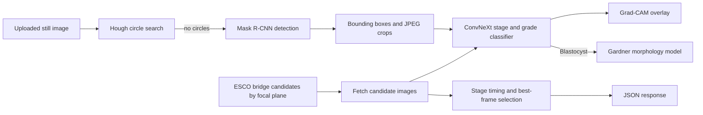

# Embryo Analysis GPU Service

## 1. Project overview

This repository contains a FastAPI service that loads image models on a GPU (or CPU fallback) and exposes embryo image detection, stage/grade classification, Gardner morphology prediction, Grad-CAM overlays, and ESCO timelapse candidate analysis. It is intended as the model-serving side of an embryo analysis application.

The service can identify embryo regions in a still image and analyze images already associated with an embryo and, for ESCO analysis, its timelapse and focal plane. Its purpose is image-level assessment and stage timing. **It does not implement frame-to-frame embryo tracking.**

## 2. Project architecture



For `/detect`, a still image is decoded, searched for complete circles using OpenCV HoughCircles, and passed to Mask R-CNN only if the circle search returns no boxes. Mask R-CNN scores and masks are filtered, and torchvision NMS removes overlapping candidate boxes. The endpoint returns boxes and crops. Separate classifier endpoints accept images or image batches. ESCO endpoints fetch candidate frames from the configured bridge, classify them, and calculate timing summaries.

### Identity and tracking terms

There is no temporal tracker, track lifecycle, association step, re-identification, or persistent ID assignment in this service. `/detect` explicitly leaves embryo-ID assignment to its caller and is stateless across requests.

- **Detection ID:** no stable detection ID is assigned. The response `detections` array is ordered per request; its position is not an identity.
- **Tracker ID:** not implemented.
- **Persistent/application ID:** the batch classifier accepts caller-supplied `embryo_ids` to key results, and ESCO analysis receives and echoes application context such as `embryo_id`. The service does not create those IDs or associate detections with them.

## 3. Input data

- Image endpoints accept uploaded file bytes and decode them with Pillow (`Image.open(...).convert("RGB")`). The repository does not restrict image extensions or specify an exhaustive supported-format list; actual decoding depends on the installed Pillow build. JPEG and PNG are typical suitable inputs.
- `/detect`, `/predict`, and `/gradcam_frame` accept one image. `/predict_batch` accepts parallel lists of image files and `embryo_ids`. `/classify_frames` accepts a list of frame images.
- ESCO endpoints accept JSON identifiers and options, then obtain candidate image URLs and image bytes from the configured ESCO bridge. The candidate request supports `timelapse_number`, `dish_position_id`, `z`, `max_size`, `diff_threshold`, `force_every`, and optional `max_concurrency`.
- No video file is decoded by this service. No required frame rate, input resolution, or fixed image dimensions are specified. Classifier preprocessing resizes to 224×224; morphology preprocessing resizes to 256 then center-crops to 224. Detection operates on the decoded image dimensions.

## 4. Detection and tracking pipeline

### Detection

The active `/detect` path first runs the Hough circle detector on the full image. It skips images whose smaller dimension is under 80 pixels; for larger images it uses median blur and HoughCircles with `dp=1.2`, `param1=55`, `param2` tried in order 42, 40, 38, 36, radius bounds derived from image size, and a minimum center distance derived from radius/image size. Only circles fully within the image are returned. Their bounding boxes are the circle extents and their crop boxes add 8% radius padding (at least 4 pixels).

If the circle detector returns no boxes, the service runs Mask R-CNN on the full image by default. Optional tile slicing can be enabled through config. Mask R-CNN detections are thresholded by confidence, binary mask area, and then box NMS. The `best.pt` YOLO model is a separate diagnostics path: it logs detections and contributes `best_pt_log` output, but its boxes do not drive the returned active detection list.

### Identity, continuation, and loss

Track creation, continuation across frames, loss handling, recovery, long-gap handling, and re-identification are not implemented. There are no frame-gap, distance, or track IoU association thresholds. NMS IoU is used only to suppress overlapping detections within one image; it does not match an embryo between images. The current implementation therefore makes no identity guarantees under occlusion, overlap, detector misses, or similar appearance.

## 5. Models

| Model | Type and role | Configuration / parameters |
|---|---|---|
| Mask R-CNN | `torchvision` Mask R-CNN ResNet-50 FPN with two classes (background and the checkpoint's foreground class); fallback embryo detector and segmentation masks | Checkpoint path `models.maskrcnn_path`; detection score default 0.55; mask probability threshold 0.50; mask area 15–100000 pixels; NMS IoU 0.45 |
| ConvNeXt Base | `torchvision.models.convnext_base`, custom 10-class head; stage/grade classification | `models.classifier_path`; preprocessing 224×224; inference batch size 32; softmax top-1. `_classify_batch` floors the reported confidence at 0.70, while `/classify_frames` returns the unmodified top-1 softmax confidence. There is no reject threshold. |
| Gardner multi-task model | `timm` ConvNeXtV2 Base backbone and expansion, ICM, and TE output heads | `models.gardners_path`; preprocessing resize 256, center crop 224. Runs for blastocyst predictions when loaded. If it fails to load, morphology results are unavailable. |
| `best.pt` | Optional Ultralytics YOLO model for per-image multi-embryo diagnostics only | Enabled by default; confidence 0.25, IoU 0.45, image size 640. It does not change `/detect` response detections. |

The classifier labels are 8 Cells A/B/C, Blastocyst A/B/C, Error Image, and Morula A/B/C. Gardner outputs expansion, ICM, TE labels and mapped scores. If ICM or TE is “Not Available,” the combined morphology score is `null`.

## 6. Configuration

`config.ini` supplies defaults. Most model and detection values can be overridden by environment variables named `EMBRYO_<SECTION>_<KEY>`; device and API key use `EMBRYO_DEVICE` and `EMBRYO_API_KEY`. ESCO bridge settings use `ESCO_BRIDGE_BASE_URL`, `ESCO_BRIDGE_API_KEY`, `ESCO_FETCH_CONCURRENCY`, and `ESCO_FETCH_TIMEOUT`.

| Setting | Local configuration value / default | Effect |
|---|---:|---|
| `models.device` | `cuda` | Requested torch device; runtime falls back to CPU if CUDA is unavailable |
| `models.batch_size` | 32 | Classifier and morphology batch chunk size |
| `detect.use_slicing` | false | Default detection uses one full-image tile |
| `detect.slice_rows`, `slice_cols` | 2, 2 | Optional tile grid when slicing is enabled |
| `detect.slice_overlap_ratio` | 0.20 | Overlap for optional tile inference |
| `detect.score_thresh` | 0.55 | Mask R-CNN score threshold; `/detect` also accepts form field `conf` |
| `detect.mask_thresh` | 0.50 | Mask probability threshold |
| `detect.nms_iou_thresh` | 0.45 | Within-image box NMS threshold |
| `detect.min_mask_area`, `max_mask_area` | 15, 100000 | Accepted binary mask area in pixels |
| `detect.tile_batch_size` | 4 | Number of tiles per Mask R-CNN call |
| `detect.use_amp` | true | CUDA autocast for Mask R-CNN when running on CUDA |
| `detect.yolo_log_enabled` | true | Enable diagnostic YOLO inference/logging |
| `app.port` | 5003 | Port used by `python main.py` |

There is no tracking configuration, frame-gap limit, or cross-frame distance/IoU threshold. Do not put API keys in documentation or commit them as config values; configure secrets through the deployment environment.

## 7. Outputs

The service returns JSON over HTTP; it does not write annotated video, CSV, reports, or tracking files.

- `/detect`: per-detection `bbox` and `crop_bbox` coordinates as `[x1, y1, x2, y2]`, score, optional mask area, base64 JPEG crop, count, optional YOLO diagnostic details, and detection timing/slicing metadata.
- `/predict`: predicted class (`ai_grade`), reported confidence, base64 Grad-CAM image, and optional Gardner morphology result.
- `/predict_batch`: results keyed by caller-provided embryo IDs, each with class, confidence, Grad-CAM image, and optional morphology.
- `/classify_frames`: per-input class index/name, top-1 confidence, and full softmax probability vector.
- `/gradcam_frame`: base64 Grad-CAM overlay at the input frame’s native resolution.
- ESCO focal-plane routes: classified candidate metadata, per-stage best frames, morphokinetics (`t8`, `tM`, `tB`, stage intervals and total time), and for all planes a recommended plane and per-plane results. Grad-CAM images are included when requested.

Bounding boxes are per-image coordinates. Trajectories and persistent detection IDs are not produced.

## 8. Project structure

| Path | Responsibility |
|---|---|
| `main.py` | FastAPI app, eager model loading, image preprocessing, detection, classification, morphology, Grad-CAM, and image endpoints |
| `esco_focal_plane_morphokinetics.py` | ESCO bridge calls, candidate image retrieval, per-plane classification, stage/frame selection, and morphokinetics endpoints |
| `config.ini` | Model paths, device, service port, detection thresholds, optional YOLO diagnostics, and bridge defaults |
| `*.pt`, `3 pt files/*.pt` | Model checkpoint artifacts present in this checkout; configured defaults refer to `best_convnextv2_base.pt`, `best_gardners.pt`, and an external Mask R-CNN path. `best.pt` is used for YOLO diagnostics. Other checkpoints are not selected by the checked-in config. |
| `multiembryo image.png` | Image asset in repository root; it is not used as an automatic command-line input |
| `uvicorn.log` | Runtime log artifact; it is not a test report and may reflect another source version |

## 9. Installation

There is no `requirements.txt`, `pyproject.toml`, setup file, or pinned environment specification in this repository. The source imports Python packages including FastAPI, Uvicorn, HTTPX, OpenCV (`cv2`), NumPy, PyTorch, Torchvision, Pillow, and (for the Gardner model) `timm`. Ultralytics is optional for YOLO diagnostics. Install versions compatible with the host’s Python, PyTorch, Torchvision, and CUDA runtime; exact versions are **Not verified from the current implementation.**

Model weights must be available at the configured paths. In particular, the checked-in Mask R-CNN path is absolute and points outside this repository; adjust the deployment environment/configuration to the actual checkpoint location. `main.py` loads Mask R-CNN and ConvNeXt eagerly at import/startup. Gardner loading is attempted but failure disables morphology predictions. CUDA is the configured device, with CPU fallback in code.

## 10. How to run

The executable entry point in the repository is:

```bash
python main.py
```

It starts Uvicorn on `0.0.0.0` using `app.port` (5003 in the checked-in config). The model checkpoints and dependencies described above must be installed before startup. The API key is read from `EMBRYO_API_KEY` or `[app] api_key`; protected requests use an `X-API-Key` header. The health endpoint is `GET /health` and does not require the key.

Example still-image detection request (replace the file and key locally):

```bash
curl -X POST http://localhost:5003/detect \
  -H 'X-API-Key: <your-api-key>' \
  -F 'file=@/path/to/embryo.png'
```

An optional multipart `conf` form field overrides the Mask R-CNN score threshold. Example classification request:

```bash
curl -X POST http://localhost:5003/predict \
  -H 'X-API-Key: <your-api-key>' \
  -F 'file=@/path/to/embryo.png'
```

Available routes in the source are `GET /health`, `POST /detect`, `/predict`, `/predict_batch`, `/classify_frames`, `/gradcam_frame`, `/esco/focal-plane-morphokinetics`, and `/esco/all-focal-planes-morphokinetics`. The ESCO routes require configured bridge access and request JSON; request fields are validated in `esco_focal_plane_morphokinetics.py`.

## 11. Testing

No test files, test directory, pytest configuration, or test command are present in this checkout. There are no tests to run from the repository. `uvicorn.log` contains service activity, but it is not an automated test suite and is not evidence of tracking correctness.

## 12. Current tracking status

### Implemented

- Single-image embryo circle detection with Mask R-CNN fallback.
- Optional within-image tile inference and NMS duplicate suppression.
- Still-image and batched classification, Grad-CAM, and optional Gardner morphology prediction.
- ESCO candidate-frame classification across focal planes and stage timing/best-frame summaries.
- Caller-supplied application IDs as result keys/context; no ID generation or detection association.

### Tested

- No automated tests are present in the checkout. The available runtime log shows historical health and detect requests, but its startup messages describe a different model-loading implementation than the current source. Current-code behavior has **Not verified from the current implementation** by an automated test run.

### In Progress

Not verified from the current implementation.

### Planned

Not verified from the current implementation.

### Known limitations

- The repository does not implement temporal tracking, stable detection IDs, track fragmentation/loss management, or re-identification.
- Circle detections are accepted only when the circle is wholly inside the image; the Hough path is skipped for images with a minimum dimension below 80 pixels.
- Mask R-CNN only runs when the circle path finds no boxes; it does not supplement a partial circle result.
- NMS can suppress overlapping boxes according to the configured 0.45 IoU threshold. This is within-image duplicate suppression and does not resolve embryo identity or occlusion.
- YOLO diagnostics may fail to load or infer; the code catches those failures and still attempts the active detector path.
- Gardner morphology is unavailable if its checkpoint/model dependencies fail to load; the code logs a warning and sets the model to `None`.
- No frame rate, resolution range, occlusion handling, or long-gap behavior is defined for tracking because no video tracker exists here.

## 13. Tracking limitations

ID switching, fragmentation, lost tracks, recovery after missed detections, re-identification, occlusion handling, and long frame gaps are **Not verified from the current implementation** because the service processes images and candidate frames independently and contains no temporal association algorithm. Similar-looking embryos are not matched by this repository. A missing detection has no track state to preserve. Overlap behavior is limited to Hough circle geometry and Mask R-CNN NMS on an individual image; correctness when embryos overlap is not established.

## Repository/source discrepancies

The checked-in `uvicorn.log` contains startup messages such as “Loading YOLO detector” and “All embryo models loaded,” while current `main.py` loads Mask R-CNN, ConvNeXt, Gardner, and optional diagnostic YOLO. It also includes successful `/detect` requests and a warning that `timm` was absent in the logged environment. Those log entries are retained as historical runtime evidence only; they do not establish the status of the code currently in this checkout. No tests or dependency manifest are present to resolve that discrepancy.

## Git workflow

This directory is a standalone Git repository with `main` as its default branch.
Local `config.ini`, environment files, model weights, logs, caches, and the local
sample image are excluded from version control.

For a fresh checkout, copy `config.example.ini` to `config.ini`, supply the model
weights separately, adjust their paths, and set `EMBRYO_API_KEY` in the deployment
environment. An empty API key disables authentication, so configure it before
exposing the service.

Set your author identity locally before the first commit:

```bash
git config --local user.name "Your Name"
git config --local user.email "you@example.com"
git status
git diff --cached
git commit -m "Initial embryo GPU service"
```

After creating an empty remote repository, connect and push it:

```bash
git remote add origin <repository-url>
git push -u origin main
```

For subsequent changes, review `git diff`, stage the intended files with
`git add <file>`, then commit and push. Keep credentials and patient images out
of source files and documentation as well as configuration files.
